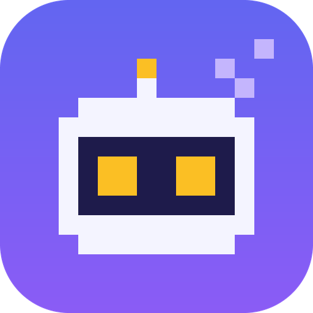
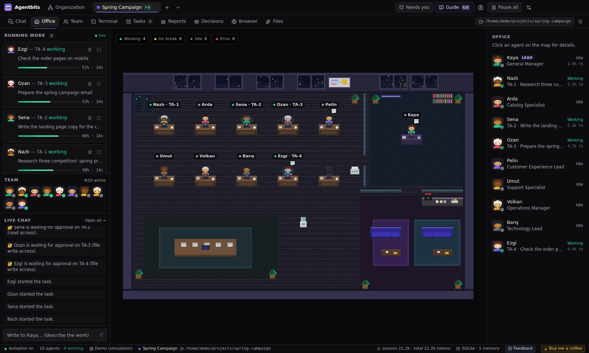
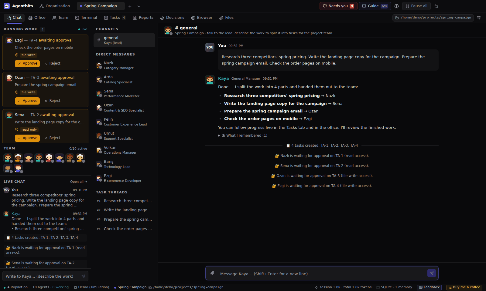
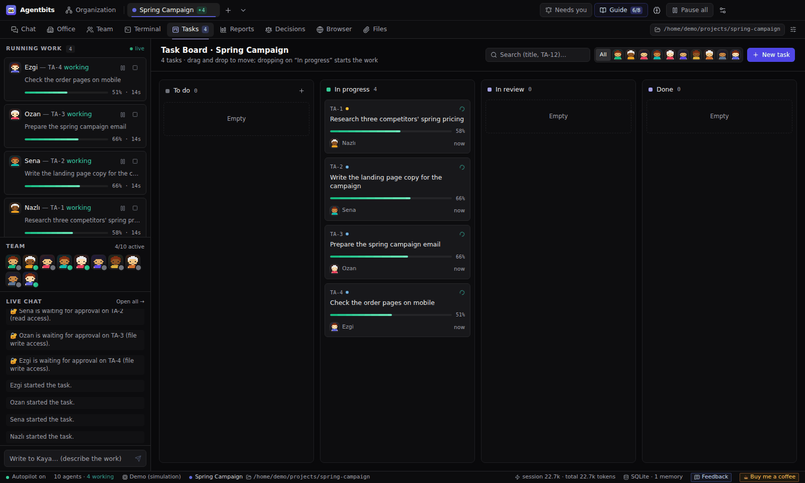
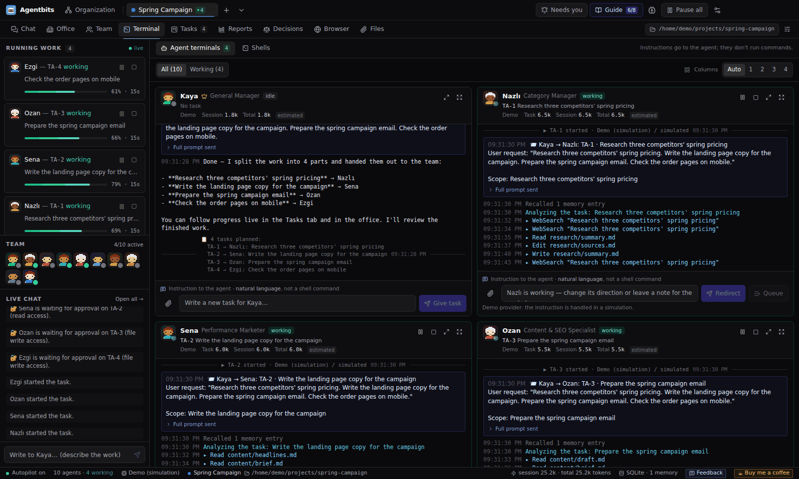
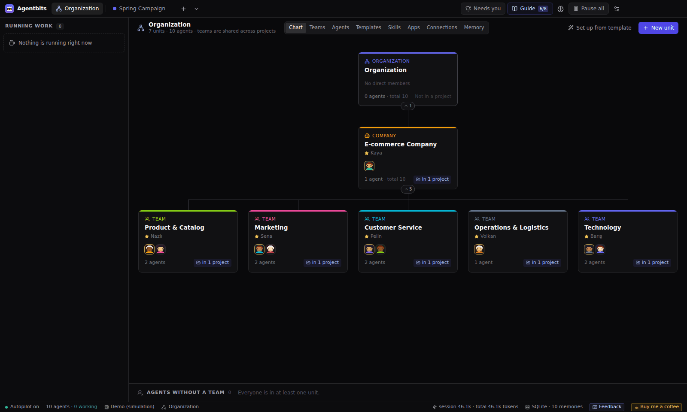
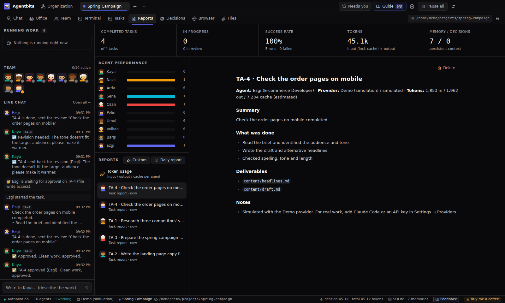
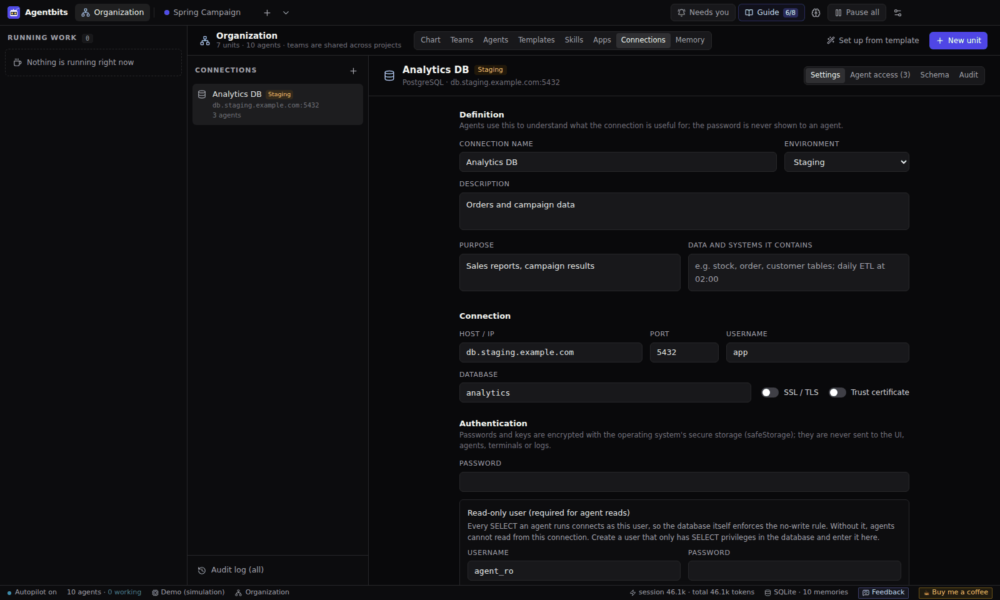
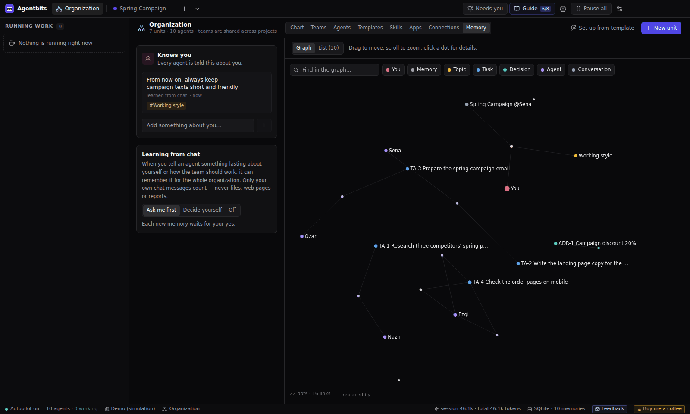
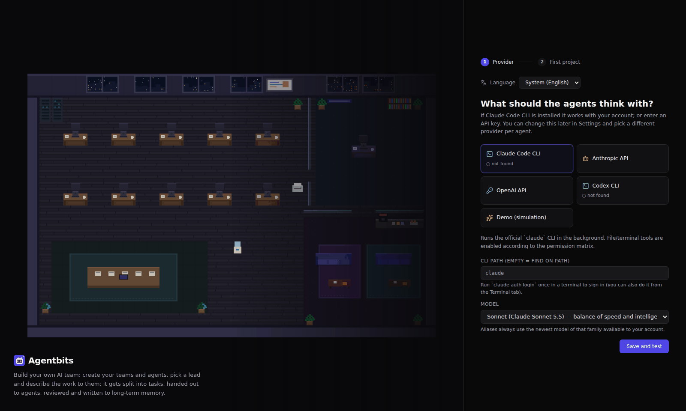

<p align="center">🇬🇧 English | <a href="README.tr.md">🇹🇷 Türkçe</a></p>

<p align="center">
  
</p>

<h1 align="center">Agentbits</h1>

<p align="center"><strong>You lead. Your AI team gets things done.</strong></p>

<p align="center">
  <a href="https://github.com/godilman/agentbits/actions/workflows/ci.yml"></a>
  
  
  
  <a href="LICENSE"></a>
  <a href="https://buymeacoffee.com/godilman"></a>
</p>

Agentbits is a desktop app where you build your own team of AI agents (a lead plus specialists with different
roles) and hand them work the way you would hand it to people. The lead splits your request into tasks, assigns
them, reviews the results and remembers what was decided. You watch the whole team work live in a pixel-art
office, on a Kanban board and in each agent's terminal, all from one window, with your data kept on your
own computer.

<p align="center">
  
</p>

## At a glance

| | |
|---|---|
| **What is it?** | A multi-agent workspace: an organization of AI agents with roles, teams and a lead, working on projects you define. |
| **What problem does it solve?** | Instead of juggling one chat window per task and copy-pasting between them, you describe the goal once. The team plans it, does it in parallel and reports back, and you can see who is doing what at any moment. |
| **How do AI teams work here?** | You talk to the project's **lead**. The lead turns your message into tasks, the autopilot hands them to free team members, each agent works with its own permissions, and the lead reviews the result (approve or send back for revision). |
| **How is it different from a single assistant?** | Several agents work at the same time, each with its own role, job description, skills and access rights. The work is visible (office, board, terminals), reviewed by a lead, and the project keeps a long-term memory and a decision log. |
| **Why use it?** | One place to run and watch AI work across projects, with real guardrails: deny-by-default access, approval prompts, an audit log, and secrets that never leave the main process. |
| **I'm not a developer. Is it for me?** | Yes. Ready-made team templates cover research, marketing, product and e-commerce work, and a free **Demo** mode lets you try everything without an API key. Real work needs an AI provider (see below); some tasks, such as browsing the web or editing files, only work with certain providers. |

## Highlights

- **Your own AI organization.** Companies, departments and teams nested as deep as you like, with agents that
  have a role, a job description, skills, a look and a permission preset. Six ready-made templates (Core Team,
  Software Team, Research & Analysis, Product Development, Marketing & Content, E-commerce Company), or start from scratch.
- **Projects with a lead.** Each project is a folder plus the teams that work on it. You chat with the lead, and it
  turns the request into tasks on the board. Only the lead talks to the team: it hands out work, sees what members
  finished and leaves them notes.
- **Parallel developers.** Duplicate an agent into twins; the lead splits work between them, tasks can wait for each
  other, and everyone sees who is working on which files. Optionally each task works in its own git working copy and is
  merged when approved, so agents never overwrite each other.
- **Race mode (optional).** A task also goes to a member on another provider or model; the lead compares both attempts
  and keeps the better one.
- **Share teams.** Export a unit or an agent as a `.agentbits` file and import one from a file or a GitHub link, with a
  full preview first. Keys, connections, tasks and chat never leave.
- **Live pixel-art office.** Agents sit at their desks while they work, take coffee breaks, and show approval or
  error badges. Click an agent to see what it is doing.
- **Kanban board.** To do → In progress → In review → Done, with drag and drop, per-task activity, logs and runs.
- **Agent terminals.** A persistent transcript for every agent: what it was asked, which tools it used, and token
  counts. You can redirect an agent, queue an instruction or give it a new task from there. Real interactive shells
  (PowerShell / bash) are available too.
- **Needs you.** One list, in the top bar, of everything waiting for you: approvals, unmerged work, reviews the lead
  couldn't decide, held tasks with their reason. Cards say why a task doesn't move.
- **Lead review, memory and decisions.** Finished work goes to the lead for review, checked against the task's acceptance
  criteria when it has them; "What changed?" shows the files and the diff. Accepted decisions are stored as
  ADR-style records, and a persistent project memory (SQLite FTS5) keeps context between runs. Optional semantic
  memory also finds notes by meaning, through your provider's embeddings (local with Ollama / LM Studio).
- **Memory that knows you.** Tell an agent how you like to work and it asks "I learned this, shall I keep it?"; every
  agent is then told about you. Memories link to topics, tasks and decisions in a graph (Organization → Memory) where
  you search, edit and forget them; a replaced memory stops reaching agents. Replies and tasks show what they remembered.
- **Files.** Attach PDF, Word, Excel, PowerPoint (also the old .doc / .xls / .ppt and .rtf), CSV, Markdown, JSON, text
  and images to chats, tasks and instructions; scanned PDFs and images are read with offline OCR (English, Turkish). Agents can read only the files they are given, and always as untrusted data.
- **Connections.** SSH servers and PostgreSQL, MySQL/MariaDB and SQL Server databases. Access is per agent and
  denied by default, Production changes need your approval, agent reads use a read-only database user, and every
  call is written to an audit log.
- **Apps (MCP) and skills.** Connect MCP servers (local or remote, with OAuth sign-in, or import them from Claude
  Desktop) with per-tool "ask me first" rules. Install instruction packs (skills) from public GitHub repos, folders,
  .zip or .md files.
- **Web reading.** Agents with the web permission can read public pages as text; local network addresses are blocked.
- **Reports.** Completed tasks, success rate, per-agent performance, task reports, a daily report and token usage
  per project and per agent, plus custom reports you describe in your own words.
- **Safety limits.** Per-run time, token and cost caps, a reviewed list of environment variables passed to CLIs, and
  secrets masked in transcripts.
- **Two languages.** English and Turkish UI. New translations are welcome.

## How it works

```
 You ──► Lead ──► Tasks ──► Agents work ──► Lead reviews ──► Done
          │         │            │                │
          │         │            │                └─ approve, or send back with notes
          │         │            └─ each with its own provider, permissions, files, connections
          │         └─ appear on the Kanban board; autopilot assigns free team members
          └─ you describe the goal in the project chat
```

1. **Set up a team.** Pick a template or create agents yourself, assign the team to a project and choose its lead.
2. **Describe the work.** Write to the lead in the project chat, for example *"Research three competitors' pricing.
   Write the landing page copy. Prepare the campaign email."*
3. **Watch it happen.** Tasks appear on the board, agents pick them up, and the office, terminals and live chat
   show progress. Agents set to "ask before each task" wait for your approval first.
4. **Review and keep.** The lead approves the work or sends it back. Reports, decisions and memory stay with the project.

## Real-world use cases

What an agent can actually do depends on its **provider** and **permissions**. The notes in brackets say what each
scenario needs.

**Software development**
- A backend, frontend and test agent working on the same codebase, with a lead that reviews the work.
  *(Claude Code CLI or Codex CLI, a project folder, file and terminal permissions.)*
- Code review, bug analysis and documentation for an existing project. *(CLI provider for reading the project
  folder. Use a git branch, because agents really change files.)*

**Research & analysis**
- Competitor and market research: collect, compare and summarize. *(Needs the web permission: Claude Code and Codex
  agents browse with the network permission, API agents read pages as text.)*
- Summarize and compare documents you attach (reports, PDFs, spreadsheets). *(Any real provider.)*

**Data & reporting**
- Analyze Excel/CSV files you attach and write up the findings. *(Any real provider.)*
- Answer questions from a database through a read-only connection, then turn the results into a report.
  *(A database connection with a read-only user, and the agent's read access to it.)*

**Content & documentation**
- Content plans, landing page copy, campaign emails, technical documentation, editing and proofreading.
  *(Any real provider. With a CLI provider, results can be saved into the project folder.)*

**Project & operations**
- Split a goal into tasks, hand them to specialists, follow progress and keep a record of decisions and results.
- Check servers with read-only SSH commands, with approval for anything that changes Production.
  *(An SSH connection and the agent's access level.)*

## Screenshots

| | |
|---|---|
| **Chat with the lead.** The request becomes four tasks, each assigned to a specialist. <br> | **Task board.** Tasks move from To do to Done as the team works. <br> |
| **Agent terminals.** What each agent was asked and what it did. <br> | **Organization.** Companies, departments and teams, each with a lead. <br> |
| **Reports.** Completed work, success rate, per-agent output and token usage. <br> | **Connections.** Per-agent database and server access with a required read-only user. <br> |
| **Memory.** The "Knows you" profile and the graph linking memories to topics, tasks and decisions. <br> | |

*Screenshots were taken in Demo mode with example data. The Demo provider simulates the work, including the
tool calls you see in terminals.*

## Supported AI providers

| Provider | What you need | What agents can do |
|---|---|---|
| **Claude Code CLI** | [Claude Code](https://code.claude.com/docs/en/overview) installed and signed in on your computer (`claude auth login`) | Read/edit files in the project folder, run terminal commands, browse the web, use connections, files, skills and apps. Each depends on the permissions you grant. |
| **Codex CLI** | Codex CLI installed and signed in (`codex login`) | Edit files inside the project folder (sandboxed), run commands, network access only with permission, use connections, files and apps |
| **Anthropic API** | An Anthropic API key | Text work plus Agentbits tools (connections, files, skills, apps). No file editing or shell. |
| **OpenAI API** | An OpenAI API key, or an OpenAI-compatible endpoint: Google Gemini, Ollama, LM Studio or your own address (local servers need no key) | Same as Anthropic API |
| **Demo (simulation)** | Nothing | Simulates realistic agent behaviour so you can explore the app for free. Doesn't do real work. |

You can mix providers: set a default and choose a different one per agent. Agentbits does not include, install or
sign in to the CLIs, and it does not offer signing in with a Claude subscription inside the app.

## Download & installation

### Installer

Download the latest version from [GitHub Releases](https://github.com/godilman/agentbits/releases/latest):

- **Windows 10/11 (x64):** `Agentbits-Setup-<version>.exe` (main target)
- **macOS:** `.dmg`, for Apple Silicon (`arm64`) or Intel (`x64`). Not tested on a real Mac yet.

The installers are **not code-signed** yet: Windows SmartScreen will warn you ("More info" → "Run anyway").
SHA-256 checksums are attached to each release as `SHA256SUMS-*.txt`.

### Run from source

**Requirements**
- [Node.js](https://nodejs.org/) **22 or newer** (needed only to run or build from source)
- Windows 10/11, macOS or Linux. The Windows installer is the main target. Running from source works on all three;
  the macOS package has not been tested on a real Mac yet, and there is no Linux package.
- Optional: Claude Code CLI or Codex CLI, or an Anthropic / OpenAI API key

```bash
git clone https://github.com/godilman/agentbits.git
cd agentbits
npm ci          # installs Electron; native modules come prebuilt (no build tools needed)
npm run dev     # start in development mode
```

| Command | What it does |
|---|---|
| `npm run dev` | Development mode with hot reload |
| `npm run typecheck` | Type checks for the main and renderer processes |
| `npm run test:unit` | Unit tests: SQL/SSH classification (including security regression cases), file extraction, skills, MCP config, review parsing, translations |
| `npm run build` / `npm start` | Production build into `out/` / run the built app |
| `npm run dist:win` | Windows installer → `release/Agentbits-Setup-<version>.exe` (x64, NSIS) |
| `npm run dist:mac` | macOS DMG (Apple Silicon + Intel); runs only on macOS or in GitHub Actions |

To try Agentbits without touching your normal data, point it at a separate folder:

```powershell
$env:AGENTBITS_DATA_DIR = "$env:TEMP\agentbits-test"; npm run dev     # Windows PowerShell
```
```bash
AGENTBITS_DATA_DIR=/tmp/agentbits-test npm run dev                     # macOS / Linux
```

## Quick start



1. **Choose a provider** on the first-run screen. Pick **Demo (simulation)** to explore without a key, or set up
   Claude Code CLI, Codex CLI, or an Anthropic / OpenAI API key. You can change this later in Settings → Providers.
2. **Name your first project.** A folder is optional for Demo and API providers and required for CLI agents.
   ⚠️ CLI agents really change files in that folder, so start with an empty folder or a git branch.
3. **Build the team.** A fresh install has no agents. Open the **Guide** (`F1`); it walks you through the steps.
   For example, Organization → Templates → *Core Team*, then assign the team to your project.
4. **Give the lead its first job** in the project chat and watch the office, board and terminals.

Useful shortcuts: `Ctrl+O` Organization · `Ctrl+1…9` project sections · `Ctrl+Tab` next project · `Ctrl+P` project
picker · `Ctrl+,` Settings · `F1` Guide.

## Architecture & tech stack

| Layer | Technology |
|---|---|
| Desktop shell | Electron 44 (main + preload + renderer, `sandbox: true`, typed IPC) |
| UI | React 19, TypeScript 5.9 (strict), Tailwind CSS 3, Zustand, lucide-react |
| Build & packaging | electron-vite / Vite 7, electron-builder (Windows NSIS, macOS DMG) |
| Database | SQLite via better-sqlite3 (WAL, FTS5 memory search, versioned migrations) |
| Office | Plain HTML5 canvas with sprites drawn in code (no image assets) |
| Terminals | xterm.js + node-pty (real PTY, pipe fallback) |
| Integrations | Claude Code / Codex CLIs, Anthropic & OpenAI APIs, MCP SDK (stdio, Streamable HTTP, OAuth), pg / mysql2 / mssql / ssh2 |
| Files | unpdf (PDF.js), fflate (Office/ZIP), papaparse (CSV), parsed in a worker thread |
| i18n | i18next + react-i18next (English, Turkish) |

Developer documentation is in [`docs/`](docs/) (currently in Turkish): [architecture](docs/ARCHITECTURE.md),
[database](docs/DATABASE.md), [feature status](docs/FEATURES.md), [security boundaries](docs/SECURITY.md),
[decisions (ADRs)](docs/DECISIONS.md), [development setup](docs/DEVELOPMENT.md) and the [changelog](docs/CHANGELOG.md).
Coding agents start at [CLAUDE.md](CLAUDE.md) / [AGENTS.md](AGENTS.md).

## Security & privacy

- **Local first.** Everything (organization, projects, chats, tasks, memory, reports, files) is stored in a SQLite
  database on your computer: `%APPDATA%\Agentbits` on Windows, `~/Library/Application Support/Agentbits` on macOS,
  `~/.config/Agentbits` on Linux. There is no Agentbits server, no account and no telemetry. Network traffic goes
  only to the providers, connections and apps you configure, to GitHub when you install a skill, and to the
  sites you open in the built-in Browser tab.
- **Secrets stay in the main process.** API keys, passwords and tokens are encrypted with the operating system
  keychain (Windows DPAPI, macOS Keychain, Linux Secret Service) and are never sent to the UI, prompts, terminals or
  logs. If no keychain is available, Agentbits refuses to store secrets.
- **Deny by default.** Agents get access to connections, files, skills and apps only when you grant it, per agent.
  Production database/server changes and "ask me first" tools wait for your approval, and every call is audited.
- **Untrusted content stays data.** File contents, query results, command output and app results reach the model
  wrapped as untrusted data, never as instructions.
- **Honest limits.** An agent with terminal and network permissions can do what your user account can do. Grant
  those only to agents you trust, or run Agentbits under a restricted OS user. The full list of what is enforced
  where is in [docs/SECURITY.md](docs/SECURITY.md).

Found a vulnerability? Please report it privately, see [SECURITY.md](SECURITY.md).

## Current limitations

Agentbits is an early release (**v0.4.0**). It does not:

- update itself (install a newer version over the old one; your data is kept);
- bundle or sign in to Claude Code / Codex CLI, or support providers that aren't OpenAI-compatible beyond the ones above;
- let API-based agents (Anthropic / OpenAI-compatible) edit files or run commands; that needs a CLI provider;
- let agents drive a full browser (clicks, forms, JavaScript; they read pages as text), run scheduled/recurring tasks,
  send OS notifications, or push to remotes / open pull requests;
- read handwriting with OCR, or host a shared gallery of teams (sharing works with files and GitHub links);
- ship signed installers, a tested macOS package or a Linux package.

Also: CLI "pause" holds the output stream but does not freeze the process on Windows, backups cover the database
but not project folders, and the MySQL and SQL Server drivers have had less testing than PostgreSQL and SSH. More
details: [docs/FEATURES.md](docs/FEATURES.md).

## Roadmap

These items are already listed as planned in [docs/FEATURES.md](docs/FEATURES.md). There are no dates.

- [ ] Code-signed installers and a macOS package tested on a real Mac
- [ ] An online gallery for shared teams and agents
- [ ] Agents driving a full browser (today: reading pages as text)
- [ ] MCP sampling and elicitation (today: tools, resources and prompts)
- [ ] Project or monthly budgets (today: per-run caps)
- [ ] More UI languages (community translations)

## Contributing

Bug reports, ideas and translations are very welcome. Please open an
[issue](https://github.com/godilman/agentbits/issues) first. Before sending a pull request, read
[CONTRIBUTING.md](CONTRIBUTING.md). Because of the license (below), contributions are accepted under the terms
described there.

## License

Agentbits is **source-available**, not open source. It is licensed under the
[PolyForm Strict License 1.0.0](LICENSE):

- ✅ You may use it for **personal and other noncommercial purposes**. Charities, schools, public research and
  government organizations may use it too.
- ❌ You may **not** modify it, make derivative works, or redistribute it.
- 💼 For commercial use or any other permission, please get in touch through
  [GitHub issues](https://github.com/godilman/agentbits/issues).

Copyright © 2026 Gökhan Dilman. Third-party packages bundled with Agentbits keep their own licenses; see
[THIRD_PARTY_NOTICES.md](THIRD_PARTY_NOTICES.md).

## Support development

Enjoying Agentbits? If this project helps you, consider buying me a coffee! Your support helps me keep building,
improving and sharing useful tools. ☕

<a href="https://buymeacoffee.com/godilman"></a>

Support is entirely voluntary: every feature of Agentbits is available to everyone, with or without a donation.
