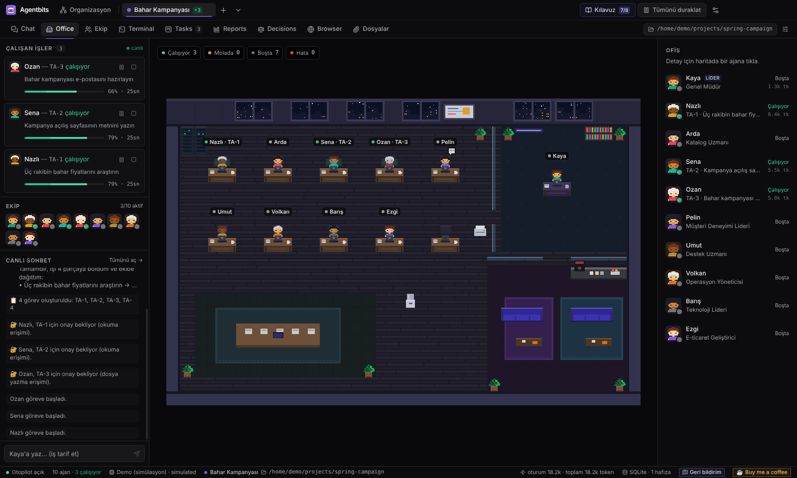
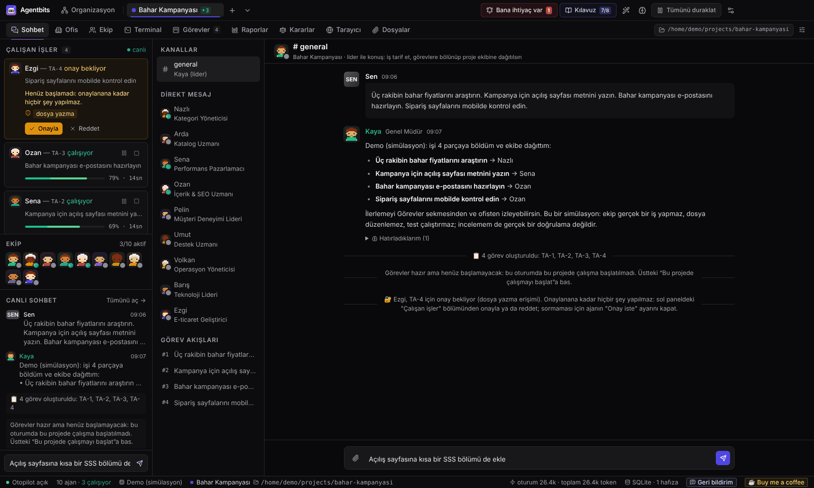
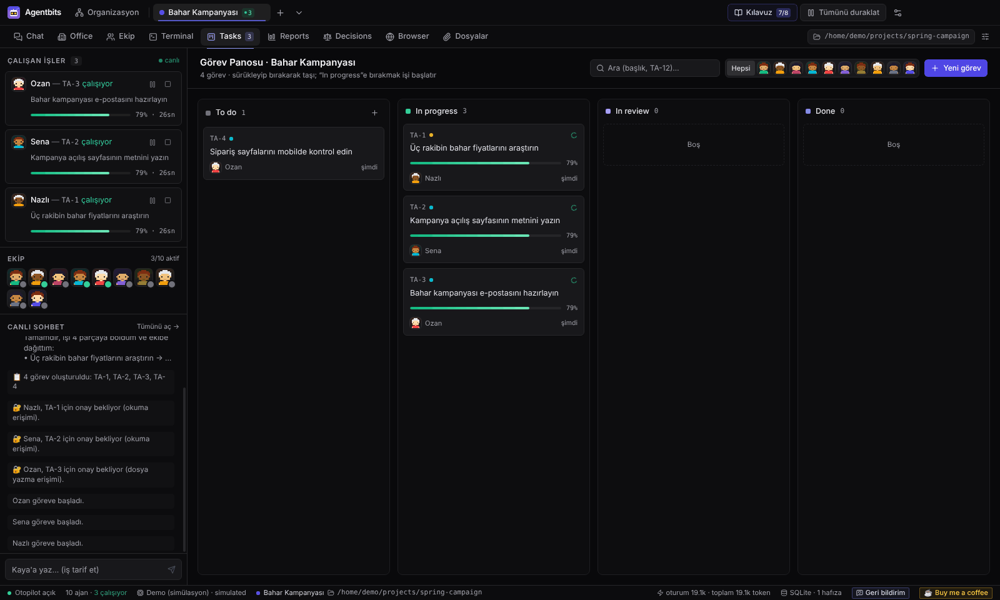
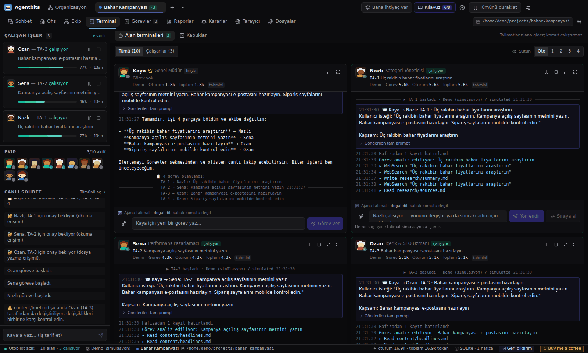
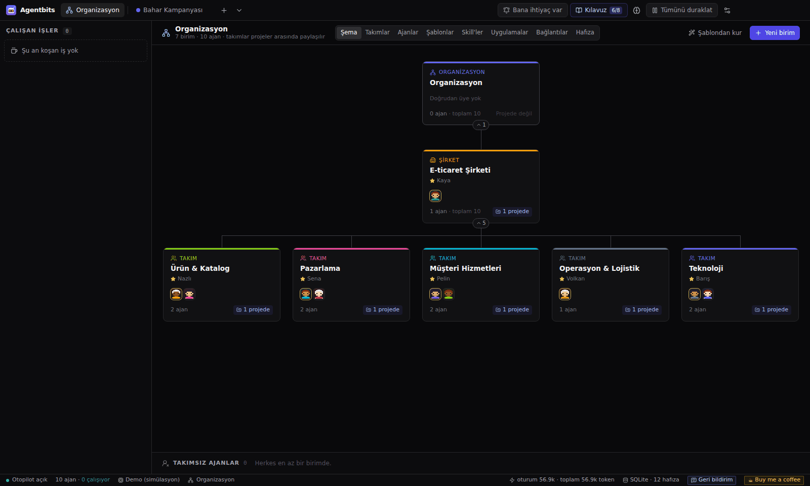
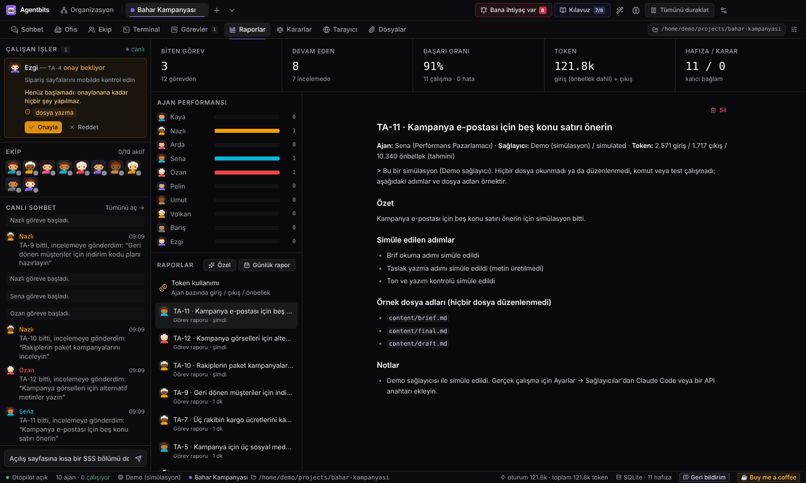
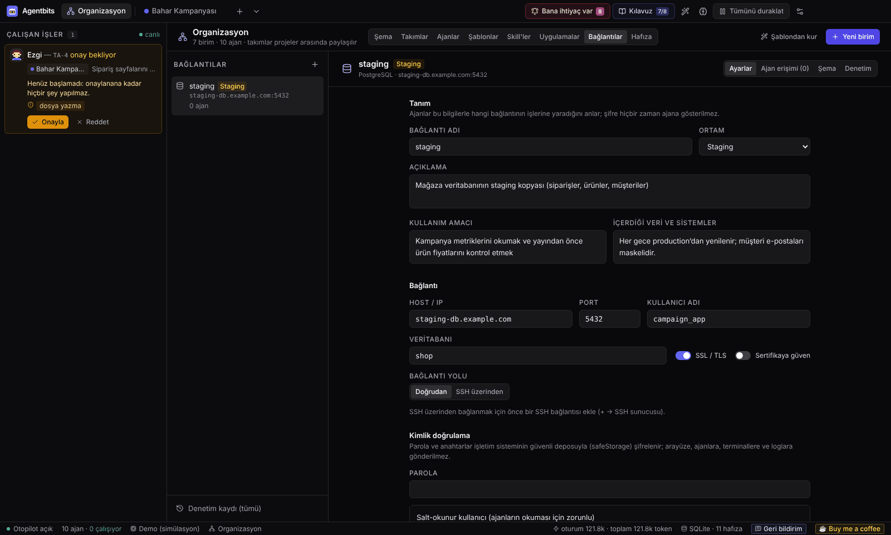
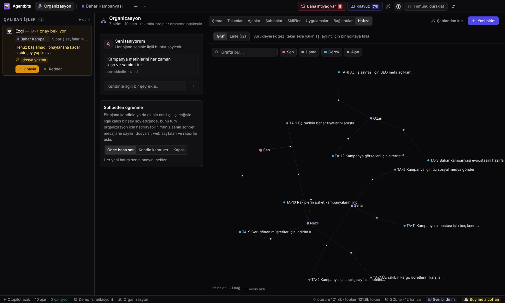
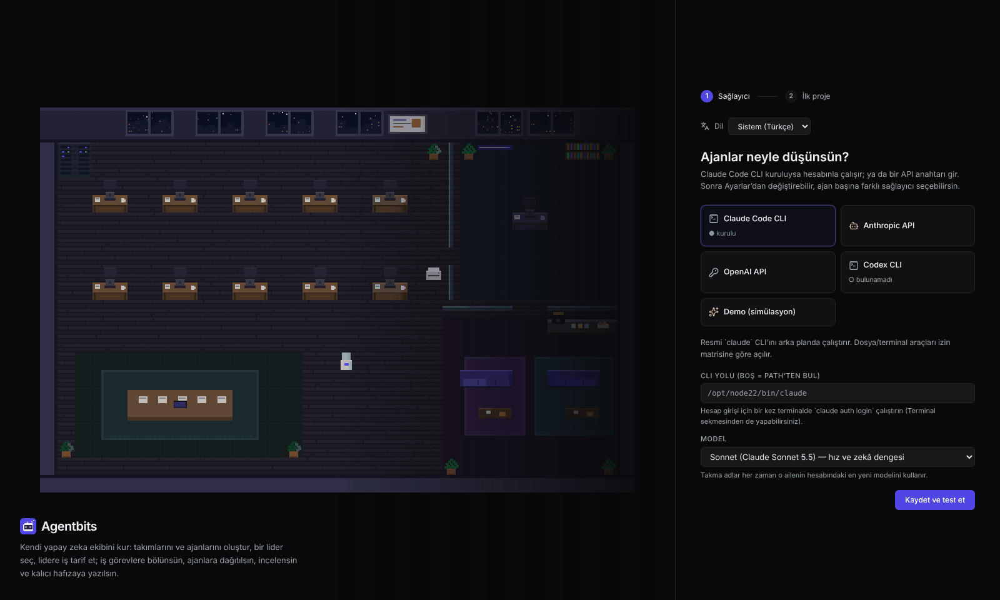

<p align="center"><a href="README.md">🇬🇧 English</a> | 🇹🇷 Türkçe</p>

<p align="center">
  
</p>

<h1 align="center">Agentbits</h1>

<p align="center"><strong>Sen yönet, yapay zeka ekibin işi bitirsin.</strong></p>

<p align="center">
  <a href="https://github.com/godilman/agentbits/actions/workflows/ci.yml"></a>
  
  
  
  <a href="LICENSE"></a>
  <a href="https://buymeacoffee.com/godilman"></a>
</p>

Agentbits, kendi yapay zeka ekibini kurduğun bir masaüstü uygulaması. Ekipte bir lider ve farklı rollerde uzmanlar
olur; onlara işi bir insana verir gibi verirsin. Lider isteğini görevlere böler, dağıtır, sonucu inceler ve alınan
kararları hatırlar. Ekibin çalışmasını pikselli bir ofiste, Kanban panosunda ve her ajanın terminalinde canlı izlersin.
Hepsi tek pencerede, verilerin de kendi bilgisayarında kalır.

<p align="center">
  
</p>

## Kısaca

| | |
|---|---|
| **Nedir?** | Çoklu ajan çalışma alanı: rolleri, takımları ve bir lideri olan yapay zeka ajanlarından oluşan bir organizasyon; senin tanımladığın projelerde çalışır. |
| **Hangi sorunu çözer?** | Her iş için ayrı sohbet penceresi açıp aralarında kopyala-yapıştır yapmak yerine hedefi bir kez anlatırsın. Ekip planlar, işleri paralel yürütür, sonucu bildirir; kimin ne yaptığını her an görürsün. |
| **Yapay zeka ekipleri nasıl çalışır?** | Projenin **lideriyle** konuşursun. Lider mesajını görevlere çevirir, otopilot görevleri boştaki üyelere verir, her ajan kendi izinleriyle çalışır, lider de sonucu inceler: onaylar ya da düzeltme notuyla geri gönderir. |
| **Tek bir asistandan farkı ne?** | Birden fazla ajan aynı anda çalışır; her birinin kendi rolü, iş tanımı, yetenekleri ve erişim hakları vardır. İş görünürdür (ofis, pano, terminaller), bir lider tarafından incelenir; projenin kalıcı hafızası ve karar kaydı tutulur. |
| **Neden kullanayım?** | Projeler genelinde yapay zeka işini tek yerden yürütür ve izlersin. Gerçek güvenlik önlemleri de vardır: varsayılan olarak her erişim kapalıdır, kritik işlemler onay bekler, her erişim denetim kaydına yazılır ve sırlar ana süreçten hiç çıkmaz. |
| **Yazılımcı değilim, işime yarar mı?** | Evet. Hazır ekip şablonları araştırma, pazarlama, ürün ve e-ticaret işlerini kapsar. Ücretsiz **Demo** moduyla API anahtarı olmadan tüm akışı simülasyon olarak deneyebilirsin. Gerçek iş için bir yapay zeka sağlayıcısı gerekir (aşağıda). Web'de gezinme ya da dosya düzenleme gibi bazı işler yalnızca belirli sağlayıcılarla çalışır. |

## Öne çıkanlar

- **Kendi yapay zeka organizasyonun.** İstediğin derinlikte şirket, departman ve takım. Ajanların rolü, iş tanımı,
  yetenekleri, görünüşü ve izin ön ayarı olur. Altı hazır şablon var (Çekirdek Ekip, Yazılım Takımı, Araştırma & Analiz,
  Ürün Geliştirme, Pazarlama & İçerik, E-ticaret Şirketi); istersen sıfırdan da kurabilirsin.
- **Lideri olan projeler.** Her proje bir klasör ve orada çalışan takımlardan oluşur. Liderle sohbet edersin, o da
  isteği panoda görevlere çevirir. Ekiple yalnızca lider konuşur: iş verir, üyelerin bitirdiklerini görür, onlara not
  bırakır. Yanıtlar yazılırken görünür; gönderilmemiş mesajlar sohbet başına taslak olarak kalır. Projeyi açmak
  kendiliğinden iş başlatmaz: *Bu projede çalışmayı başlat* dersin.
- **Paralel yazılımcılar.** Bir ajanı ikizlere çoğaltırsın; lider işi aralarında paylaştırır, görevler birbirini
  bekleyebilir, kimin hangi dosyada çalıştığını herkes görür. İstersen her görev kendi git çalışma kopyasında çalışır ve
  onaylanınca birleştirilir; ajanlar birbirinin üzerine yazmaz.
- **Yarış modu (isteğe bağlı).** Görev başka sağlayıcı ya da modeldeki bir üyeye de verilir; lider iki denemeyi
  karşılaştırıp iyi olanı tutar.
- **Takım paylaşımı.** Bir birimi ya da ajanı `.agentbits` dosyası olarak dışa aktarırsın; dosyadan ya da GitHub
  bağlantısından, önce her şeyi önizleyerek içe aktarırsın. Anahtarlar, bağlantılar, görevler ve sohbet asla çıkmaz.
- **Canlı pikselli ofis.** Ajanlar çalışırken masalarında oturur, kahve molası verir, onay ya da hata rozetleri
  gösterir. Ne yaptığını görmek için bir ajana tıklaman yeter.
- **Kanban panosu (Görevler).** Yapılacak → Devam eden → İncelemede → Bitti. Sürükle-bırak, görev başına akış, log ve
  çalışmalar. Çalışan görevi Bitti'ye taşımak önce sorar, hiçbir şeyi kendiliğinden birleştirmez. "Görevi iptal et"
  çalışmasını durdurur, onaylarını reddeder; sen yeniden açana kadar hiçbir şey onu almaz, geçmişi kalır.
- **Ajan terminalleri.** Her ajanın kalıcı bir dökümü olur: kendisine ne sorulduğu, hangi araçları kullandığı, kaç
  token harcadığı. Buradan ajanı yönlendirebilir, talimatı sıraya koyabilir ya da yeni görev verebilirsin. Gerçek
  etkileşimli kabuklar (PowerShell / bash) da var.
- **Bana ihtiyaç var.** Üst barda, seni bekleyen her şeyin tek listesi: onaylar, birleştirilmemiş işler, liderin karar
  veremediği incelemeler, nedeniyle bekletilen görevler. Kart, görevin neden ilerlemediğini söyler. Hata veren görev
  hemen bekletilir, nedeni sade dille yazılır; sen yeniden deneyene kadar başlamaz. Dar istisna (Ayarlar → Genel →
  "Otomatik toparlanma"): geçici bir sağlayıcı hatasından (ağ, zaman aşımı, aşırı yük) sonra API sağlayıcısındaki ya
  da Demo'daki lider incelemesi yeniden denenir; API sağlayıcısındaki ya da Demo'daki çalışan ise yalnız kaydı dışarıda
  hiçbir şey değiştirmediğini gösteriyorsa yeniden çalışır — görev başına en fazla iki ek deneme. Claude Code ve Codex
  çalışmaları ve incelemeleri kendiliğinden yeniden denenmez. Her bekleme proje sohbetinde de
  yalnızca gerçekten işe yarayan eylemlerle bir karttır (çalışmayı onayla ya da reddet, yeniden dene, incelemeyi yeniden
  dene, incele ve birleştir); bağlantı ve uygulama istekleri onay penceresini açar, her tıklama yeniden denetlenir ve bir
  kez uygulanır.
- **Bildirimler.** Agentbits önde değilken yanıtları, onayları, seni bekleyen kararları ve biten işleri sistem
  bildirimiyle söyler (gruplanmış, bayatlamış olanlar düşer); tıklama yalnız ilgili yeri açar. Ayarlar → Genel → Bildirimler.
- **Lider incelemesi, hafıza ve kararlar.** Biten iş liderin incelemesine gider; görevin kabul kriterleri varsa her biri
  kontrol edilir, "Ne değişti?" dosyaları ve farkı gösterir; her görevin **Sonuç** kutusu neyin çalıştığını, hangi
  dosyaların değiştiğini ve kimin değerlendirdiğini gösterir. Kabul edilen kararlar ADR tarzında
  kaydedilir, kalıcı proje hafızası (SQLite FTS5) da bağlamı çalışmalar arasında korur. İsteğe bağlı anlamsal hafıza,
  sağlayıcının embedding'iyle notları anlamıyla da bulur (Ollama / LM Studio ile yerelde).
- **Seni tanıyan hafıza.** Bir ajana nasıl çalışmayı sevdiğini söylersin, "Bunu öğrendim, kaydedeyim mi?" diye sorar;
  sonra her ajana seninle ilgili bu bilgiler söylenir. Hatıralar bir grafta konulara, görevlere ve kararlara bağlanır
  (Organizasyon → Hafıza); orada arar, düzeltir, unutturursun. Yerini yenisi alan hatıra ajanlara artık gitmez. Yanıtlar
  ve görevler neyi hatırladıklarını gösterir.
- **Proje hafızası klasörü.** Her proje, klasöründeki `.agentbits/memory/` içinde düz Markdown notlar tutabilir. Kendi
  notlarını oraya kopyalarsın, her ajan görür; lider işi onlara göre böler, ajanlar saklamaya değer bir şey öğrendiğinde ya
  da "unutma" dediğinde kısa, tarihli not ekler (varsayılan olarak önce sana sorar). Ajanlar yalnız ekler; senin yazdığın
  metin hiç değişmez. Notlar proje bilgisidir, talimat değildir; hiçbir ajanın erişimini genişletmez.
- **Dosyalar.** Sohbetlere, görevlere ve talimatlara PDF, Word, Excel, PowerPoint (eski .doc / .xls / .ppt ve .rtf de),
  CSV, Markdown, JSON, metin ve görsel ekleyebilirsin; taranmış PDF'ler ve görseller çevrimdışı OCR ile okunur (İngilizce,
  Türkçe). Ajanlar yalnızca kendilerine verilen dosyaları okur ve içeriği her zaman güvenilmeyen veri olarak ele alır.
- **Bağlantılar.** SSH sunucuları ve PostgreSQL, MySQL/MariaDB, SQL Server veritabanları. Erişim ajan başına verilir ve
  varsayılan olarak kapalıdır. Production değişiklikleri senin onayını bekler, ajan okumaları salt-okunur bir
  veritabanı kullanıcısıyla yapılır, her çağrı denetim kaydına yazılır. Bir veritabanına SSH bağlantılarından biri
  üzerinden de bağlanabilirsin: şifreli tüneli uygulama kendisi açar, böylece o sunucudaki TLS'siz bir veritabanı da çalışır.
- **Uygulamalar (MCP) ve skill'ler.** MCP sunucularını bağlayabilirsin: yerel ya da uzak, OAuth girişli ya da Claude
  Desktop'tan içe aktarılmış. Her araç için "önce bana sor" kuralı koyabilirsin. Talimat paketlerini (skill) herkese
  açık GitHub depolarından, klasörden, .zip ya da .md dosyasından kurabilirsin.
- **Web okuma.** Web izni olan ajanlar herkese açık sayfaları metin olarak okuyabilir; yerel ağ adresleri engellidir.
- **Raporlar.** Tamamlanan görevler, başarı oranı, ajan bazında performans, görev raporları, günlük rapor ve proje ve
  ajan bazında token kullanımı; ayrıca kendi cümlelerinle tarif ettiğin özel raporlar.
- **Güvenlik sınırları.** Çalışma başına süre, token ve maliyet tavanı, CLI'lara geçen ortam değişkenlerinin denetlenmiş
  listesi ve dökümlerde maskelenen sırlar. Yarıda kalacak iş varsa kapatırken sayılarıyla sorar.
- **İki dil.** İngilizce ve Türkçe arayüz. Yeni çevirilere açığız. Klavyeyle rahat (görünür odak, Escape en üstteki
  katmanı kapatır), dar pencerede de kullanılır.

## Nasıl çalışır?

```
 Sen ──► Lider ──► Görevler ──► Ajanlar çalışır ──► Lider inceler ──► Tamam
           │          │               │                   │
           │          │               │                   └─ onaylar ya da notla geri gönderir
           │          │               └─ her birinin kendi sağlayıcısı, izinleri, dosyaları, bağlantıları
           │          └─ Kanban panosunda görünür; otopilot boştaki üyelere atar
           └─ hedefi proje sohbetinde anlatırsın
```

1. **Ekibi kur.** Bir şablon seç ya da ajanları kendin oluştur, takımı projeye ata ve liderini belirle.
2. **İşi anlat.** Proje sohbetinde lidere yaz. Örneğin: *"Üç rakibin fiyatlarını araştırın. Açılış sayfası
   metnini yazın. Kampanya e-postasını hazırlayın."*
3. **İzle.** Görevler panoda belirir; *Bu projede çalışmayı başlat* dediğinde ajanlar işi alır; ofis, terminaller ve canlı sohbet ilerlemeyi gösterir.
   **Onay iste** açık olan ajanlar önce senin onayını bekler.
4. **İncele ve sakla.** Lider işi onaylar ya da geri gönderir. Raporlar, kararlar ve hafıza projede kalır.

## Gerçek kullanım senaryoları

Bir ajanın gerçekte neler yapabileceği **sağlayıcısına** ve **izinlerine** bağlıdır. Parantez içindeki notlar her
senaryonun neye ihtiyaç duyduğunu söyler.

**Yazılım geliştirme**
- Aynı kod tabanında çalışan backend, frontend ve test ajanları, işi inceleyen bir liderle.
  *(Claude Code CLI ya da Codex CLI, proje klasörü, dosya ve terminal izinleri.)*
- Mevcut bir projede kod inceleme, hata analizi ve dokümantasyon. *(Proje klasörünü okumak için CLI sağlayıcısı.
  Ajanlar dosyaları gerçekten değiştirdiği için bir git dalı kullan.)*

**Araştırma ve analiz**
- Rakip ve pazar araştırması: bilgiyi topla, karşılaştır, özetle. *(Web izni gerekir: Claude Code ve Codex ajanları ağ
  izniyle gezinir, API ajanları sayfaları metin olarak okur.)*
- Eklediğin belgeleri (raporlar, PDF'ler, tablolar) özetleme ve karşılaştırma. *(Herhangi bir gerçek sağlayıcı.)*

**Veri ve raporlama**
- Eklediğin Excel/CSV dosyalarını analiz edip bulguları yazıya dökme. *(Herhangi bir gerçek sağlayıcı.)*
- Salt-okunur bir bağlantı üzerinden veritabanındaki sorulara yanıt bulma ve sonuçları rapora çevirme.
  *(Salt-okunur kullanıcısı olan bir veritabanı bağlantısı ve ajanın bu bağlantıya okuma izni.)*

**İçerik ve dokümantasyon**
- İçerik planı, açılış sayfası metni, kampanya e-postası, teknik dokümantasyon, metin düzenleme ve son okuma.
  *(Herhangi bir gerçek sağlayıcı. CLI sağlayıcısıyla sonuçlar proje klasörüne de kaydedilebilir.)*

**Proje ve operasyon**
- Bir hedefi görevlere bölme, uzmanlara dağıtma, ilerlemeyi takip etme, kararları ve sonuçları kayda geçirme.
- Sunucuları salt-okunur SSH komutlarıyla kontrol etme; Production'da değişiklik yapan her şey onay ister.
  *(SSH bağlantısı ve ajanın erişim seviyesi.)*

## Ekran görüntüleri

| | |
|---|---|
| **Liderle sohbet.** İstek dört göreve ayrılır, her biri bir uzmana atanır. <br> | **Görev panosu.** Ekip çalıştıkça görevler Yapılacak'tan Bitti'ye ilerler. <br> |
| **Ajan terminalleri.** Her ajana ne sorulduğu ve ne yaptığı. <br> | **Organizasyon.** Şirket, departman ve takımlar; her birinin lideri var. <br> |
| **Raporlar.** Tamamlanan işler, başarı oranı, ajan başına üretim ve token kullanımı. <br> | **Bağlantılar.** Zorunlu salt-okunur kullanıcıyla, ajan bazında veritabanı ve sunucu erişimi. <br> |
| **Hafıza.** "Seni tanıyorum" profili ve hatıraları görevlere ve ajanlara bağlayan graf. <br> | |

*Ekran görüntüleri Demo modunda (v0.8.0) örnek verilerle alındı. Demo işi yalnızca taklit eder, hiçbir araç
çağırmaz; taklit edilen her adım "simülasyon" diye etiketlenir.*

## Desteklenen yapay zeka sağlayıcıları

| Sağlayıcı | Gerekenler | Ajanlar neler yapabilir |
|---|---|---|
| **Claude Code CLI** | Bilgisayarında kurulu ve giriş yapılmış [Claude Code](https://code.claude.com/docs/en/overview) (`claude auth login`) | Proje klasöründe dosya okuma/düzenleme, terminal komutları, web'de gezinme, bağlantılar, dosyalar, skill'ler ve uygulamalar. Hepsi verdiğin izinlere bağlıdır. |
| **Codex CLI** | Kurulu ve giriş yapılmış Codex CLI (`codex login`) | Proje klasörü içinde dosya düzenleme (sandbox'lı), komut çalıştırma, yalnızca izinle ağ erişimi, bağlantılar, dosyalar ve uygulamalar |
| **Anthropic API** | Anthropic API anahtarı | Metin işleri ve Agentbits araçları (bağlantılar, dosyalar, skill'ler, uygulamalar). Dosya düzenleme ya da kabuk yok. |
| **OpenAI API** | OpenAI API anahtarı ya da OpenAI uyumlu bir uç nokta: Google Gemini, Ollama, LM Studio ya da kendi adresin (yerel sunucuda anahtar gerekmez) | Anthropic API ile aynı |
| **Demo (simülasyon)** | Hiçbir şey | Akışı ücretsiz taklit eder; hiçbir araç çağırmaz, her adımı simülasyon diye etiketler. Gerçek iş yapmaz. |

Sağlayıcıları karıştırabilirsin: bir varsayılan belirler, ajan bazında başka bir sağlayıcı seçersin. Agentbits CLI'ları
içermez, kurmaz ve onlarda oturum açmaz; uygulama içinde Claude aboneliğiyle giriş de sunmaz.

## İndirme ve kurulum

### Kurulum dosyası

Son sürümü [GitHub Releases](https://github.com/godilman/agentbits/releases/latest) sayfasından indirebilirsin:

- **Windows 10/11 (x64):** `Agentbits-Setup-<sürüm>.exe` (ana hedef)
- **macOS:** Apple Silicon (`arm64`) ya da Intel (`x64`) için `.dmg`. Gerçek bir Mac'te açıldı; her özellik orada henüz denenmedi. İlk açılışta Apple'ın "doğrulayamadı" uyarısı çıkar (paketler onaylı değil): **Sistem Ayarları → Gizlilik ve Güvenlik → Yine de Aç**.

Kurulum dosyaları henüz **kod imzalı değil**: Windows SmartScreen uyarı verir ("Ek bilgi" → "Yine de çalıştır").
SHA-256 özetleri her sürümde `SHA256SUMS-*.txt` dosyalarında.

### Kaynaktan çalıştırma

**Gereksinimler**
- [Node.js](https://nodejs.org/) **22.6 ya da üstü** (yalnızca kaynaktan çalıştırmak ya da derlemek için)
- Windows 10/11, macOS ya da Linux. Ana hedef Windows kurulum dosyası. Kaynaktan çalıştırma üçünde de çalışır; macOS
  paketi henüz tam denenmedi, Linux paketi yok.
- İsteğe bağlı: Claude Code CLI ya da Codex CLI, veya bir Anthropic / OpenAI API anahtarı

```bash
git clone https://github.com/godilman/agentbits.git
cd agentbits
npm ci          # Electron'u kurar; yerel modüller hazır derlenmiş gelir (derleme araçları gerekmez)
npm run dev     # geliştirme modunda başlatır
```

| Komut | Ne yapar |
|---|---|
| `npm run dev` | Anında yenilemeli geliştirme modu |
| `npm run typecheck` | Main ve renderer süreçleri için tip kontrolü |
| `npm run test:unit` | Birim testleri: SQL/SSH sınıflandırma (güvenlik regresyon örnekleri dahil), dosya çıkarma, skill'ler, MCP yapılandırması, inceleme kararı, sağlayıcı ve orkestrasyon yardımcıları, bildirimler, çeviriler |
| `npm run test:renderer` | Renderer mantık testleri (taslaklar, yerleşim, odak/Escape katmanları, bildirim tıklaması); tarayıcı yok |
| `npm run test:e2e` | Main sürecin uçtan uca testleri: gerçek SQLite, git ve SSH tüneli, taklit sağlayıcılar; pencere yok |
| `npm run build` / `npm start` | `out/` klasörüne üretim derlemesi / derlenmiş uygulamayı çalıştırma |
| `npm run dist:win` | Windows kurulum dosyası → `release/Agentbits-Setup-<sürüm>.exe` (x64, NSIS) |
| `npm run dist:mac` | macOS DMG (Apple Silicon + Intel); yalnızca macOS'ta ya da GitHub Actions'ta çalışır |

Normal verilerine dokunmadan denemek için ayrı bir klasör göster:

```powershell
$env:AGENTBITS_DATA_DIR = "$env:TEMP\agentbits-test"; npm run dev     # Windows PowerShell
```
```bash
AGENTBITS_DATA_DIR=/tmp/agentbits-test npm run dev                     # macOS / Linux
```

## Hızlı başlangıç



1. İlk açılış ekranında **bir sağlayıcı seç**. Anahtarsız keşif için **Demo (simülasyon)** seçebilir ya da Claude
   Code CLI, Codex CLI veya bir Anthropic / OpenAI API anahtarı ayarlayabilirsin. Sonra Ayarlar → Sağlayıcılar'dan
   değiştirebilirsin.
2. **İlk projene ad ver.** Klasör Demo ve API sağlayıcılarında isteğe bağlı, CLI ajanlarında zorunludur.
   ⚠️ CLI ajanları o klasördeki dosyaları gerçekten değiştirir; boş bir klasörle ya da bir git dalıyla başla.
3. **Ekibi kur.** Yeni kurulumda hiç ajan yoktur. **Kılavuz**'u (`F1`) aç, adım adım yol gösterir. Örneğin:
   Organizasyon → Şablonlar → *Çekirdek Ekip*, sonra takımı projene ata.
4. Proje sohbetinde **lidere ilk işini ver**, sonra **Bu projede çalışmayı başlat**'a bas (projeyi açmak kendiliğinden
   iş başlatmaz). Ofisi, panoyu ve terminalleri izle.

Kullanışlı kısayollar: `Ctrl+O` Organizasyon · `Ctrl+1…9` proje bölümleri · `Ctrl+Tab` sonraki proje · `Ctrl+P` proje
seçici · `Ctrl+,` Ayarlar · `F1` Kılavuz.

## Mimari ve teknoloji yığını

| Katman | Teknoloji |
|---|---|
| Masaüstü kabuğu | Electron 44 (main + preload + renderer, `sandbox: true`, tipli IPC) |
| Arayüz | React 19, TypeScript 5.9 (strict), Tailwind CSS 3, Zustand, lucide-react |
| Derleme ve paketleme | electron-vite / Vite 7, electron-builder (Windows NSIS, macOS DMG) |
| Veritabanı | better-sqlite3 ile SQLite (WAL, FTS5 hafıza araması, sürümlü migration'lar) |
| Ofis | Kodla çizilen sprite'larla saf HTML5 canvas (görsel dosyası yok) |
| Terminaller | xterm.js + node-pty (gerçek PTY, yoksa pipe) |
| Entegrasyonlar | Claude Code / Codex CLI'ları, Anthropic ve OpenAI API'leri, MCP SDK (stdio, Streamable HTTP, OAuth), pg / mysql2 / mssql / ssh2 |
| Dosyalar | unpdf (PDF.js), fflate (Office/ZIP), papaparse (CSV); ayrıştırma ayrı bir worker'da |
| Çoklu dil | i18next + react-i18next (İngilizce, Türkçe) |

Geliştirici belgeleri [`docs/`](docs/) altında (Türkçe): [mimari](docs/ARCHITECTURE.md),
[veritabanı](docs/DATABASE.md), [özellik durumu](docs/FEATURES.md), [güvenlik sınırları](docs/SECURITY.md),
[kararlar (ADR)](docs/DECISIONS.md), [geliştirme ortamı](docs/DEVELOPMENT.md) ve [değişiklik geçmişi](docs/CHANGELOG.md).
Kodlama ajanları [CLAUDE.md](CLAUDE.md) / [AGENTS.md](AGENTS.md) ile başlar.

## Güvenlik ve gizlilik

- **Önce yerel.** Her şey (organizasyon, projeler, sohbetler, görevler, hafıza, raporlar, dosyalar) bilgisayarındaki
  bir SQLite veritabanında saklanır: Windows'ta `%APPDATA%\Agentbits`, macOS'ta
  `~/Library/Application Support/Agentbits`, Linux'ta `~/.config/Agentbits`. Agentbits sunucusu, hesap ya da
  telemetri yoktur. Ağ trafiği yalnızca senin ayarladığın sağlayıcılara (ve CLI'larına), bağlantılara ve
  uygulamalara, skill kurarken ya da paylaşılan takım içe aktarırken GitHub'a, web izni olan ajanın okuduğu herkese
  açık sayfalara ve yerleşik Tarayıcı sekmesinde açtığın sitelere gider.
- **Sırlar ana süreçte kalır.** API anahtarları, parolalar ve token'lar işletim sisteminin anahtar zinciriyle
  şifrelenir (Windows DPAPI, macOS Keychain, Linux Secret Service). Arayüze, prompt'lara, terminallere ve loglara asla
  gönderilmez. Anahtar zinciri yoksa Agentbits sır saklamayı reddeder.
- **Varsayılan olarak kapalı.** Ajanlar bağlantılara, dosyalara, skill'lere ve uygulamalara ancak sen izin verirsen,
  ajan bazında erişir. Production veritabanı/sunucu değişiklikleri ve "önce bana sor" araçları onayını bekler, her
  çağrı denetim kaydına yazılır.
- **Güvenilmeyen içerik veri olarak kalır.** Dosya içerikleri, sorgu sonuçları, komut çıktıları ve uygulama sonuçları
  modele talimat olarak değil, güvenilmeyen veri olarak işaretlenmiş şekilde gider.
- **Kilit ekranında bildirim.** Bildirim proje ve ajan adını, görev başlığının ilk 50 karakterini taşır (sır benzeri
  metin maskelenir); Windows bunu kilit ekranında gösterebilir. Ayarlar → Genel → Bildirimler'den kapatılır.
- **Sınırlar açıkça yazılı.** Terminal ve ağ izni olan bir ajan, senin kullanıcı hesabının yapabildiği her şeyi
  yapabilir. Bu izinleri yalnızca güvendiğin ajanlara ver ya da Agentbits'i kısıtlı bir işletim sistemi kullanıcısıyla
  çalıştır. Neyin nerede zorlandığının tam listesi: [docs/SECURITY.md](docs/SECURITY.md).

Bir güvenlik açığı mı buldun? Lütfen gizli olarak bildir: [SECURITY.md](SECURITY.md).

## Mevcut sınırlamalar

Agentbits erken bir sürümdür (**v0.13.0**). Şunları yapmaz:

- kendini güncellemek: yeni sürümleri kontrol edip haber verir, kurulumu indirme sayfasından yaparsın (eskisinin
  üzerine; verilerin korunur ve yükseltme değiştirmeden önce yedeklenir);
- Claude Code / Codex CLI'ı içermek ya da onlarda oturum açmak; yukarıdakiler dışında OpenAI uyumlu olmayan sağlayıcıları
  desteklemek;
- API tabanlı ajanlara (Anthropic / OpenAI uyumlu) dosya düzenletmek ya da komut çalıştırtmak (bunun için CLI sağlayıcısı
  gerekir);
- ajanlara tam bir tarayıcı kullandırmak (tıklama, form, JavaScript; sayfaları metin olarak okurlar); zamanlanmış /
  tekrarlanan görev, uzak depoya gönderme ya da pull request;
- el yazısını OCR ile okumak ya da paylaşılan takımlar için çevrimiçi bir galeri sunmak (paylaşım dosya ve GitHub
  bağlantısıyla çalışır);
- imzalı kurulum dosyası, denenmiş macOS paketi ya da Linux paketi sunmak.

Ayrıca: sistem bildirimleri ve kapatma uyarısı her gerçek Windows kurulumunda henüz denenmedi (kilit ekranı,
Odak Yardımı), macOS'ta denenmedi. CLI'larda "duraklat" çıktı akışını bekletir ama Windows'ta süreci dondurmaz; yedekler veritabanını kapsar,
proje klasörlerini kapsamaz; MySQL ve SQL Server sürücüleri PostgreSQL ve SSH kadar test edilmedi. Ayrıntılar:
[docs/FEATURES.md](docs/FEATURES.md).

## Yol haritası

Planlanan ya da düşünülen maddeler, tarih verilmedi; güncel durum [docs/FEATURES.md](docs/FEATURES.md)'de.

- [ ] Kod imzalı kurulum dosyaları ve imzalı, onaylı macOS paketleri
- [ ] Paylaşılan takımlar ve ajanlar için çevrimiçi galeri
- [ ] Ajanların tam tarayıcı kullanması (bugün: sayfaları metin olarak okuma)
- [ ] MCP sampling ve elicitation (bugün: araçlar, kaynaklar ve istemler)
- [ ] Proje ya da aylık bütçe (bugün: çalışma başına tavan)
- [ ] Daha fazla arayüz dili (topluluk çevirileri)

## Katkıda bulunma

Hata bildirimleri, fikirler ve çeviriler çok değerli. Lütfen önce bir
[issue](https://github.com/godilman/agentbits/issues) aç. Pull request göndermeden önce
[CONTRIBUTING.md](CONTRIBUTING.md) dosyasını oku. Lisans gereği (aşağıda) katkılar orada anlatılan koşullarla kabul edilir.

## Lisans

Agentbits **kaynağı açık (source-available)** bir projedir ama açık kaynak değildir.
[PolyForm Strict License 1.0.0](LICENSE) ile lisanslanmıştır:

- ✅ **Kişisel ve diğer ticari olmayan amaçlarla** kullanabilirsin. Hayır kurumları, okullar, kamu araştırma kurumları
  ve devlet kurumları da kullanabilir.
- ❌ Değiştiremez, türev çalışma yapamaz ve yeniden dağıtamazsın.
- 💼 Ticari kullanım ya da başka bir izin için lütfen [GitHub issues](https://github.com/godilman/agentbits/issues)
  üzerinden iletişime geç.

Lisans metninin bağlayıcı olan sürümü İngilizce [LICENSE](LICENSE) dosyasıdır. Telif hakkı © 2026 Gökhan Dilman.
Agentbits ile birlikte gelen üçüncü taraf paketler kendi lisanslarını korur: [THIRD_PARTY_NOTICES.md](THIRD_PARTY_NOTICES.md).

## Geliştirmeye destek ol

Agentbits'i beğendin mi? Bu proje işine yarıyorsa bana bir kahve ısmarlamayı düşünebilirsin! Desteğin, faydalı
araçlar geliştirmeye, onları iyileştirmeye ve paylaşmaya devam etmemi sağlıyor. ☕

<a href="https://buymeacoffee.com/godilman"></a>

Destek tamamen gönüllüdür: Agentbits'in tüm özellikleri bağış yapan ya da yapmayan herkese açıktır.
